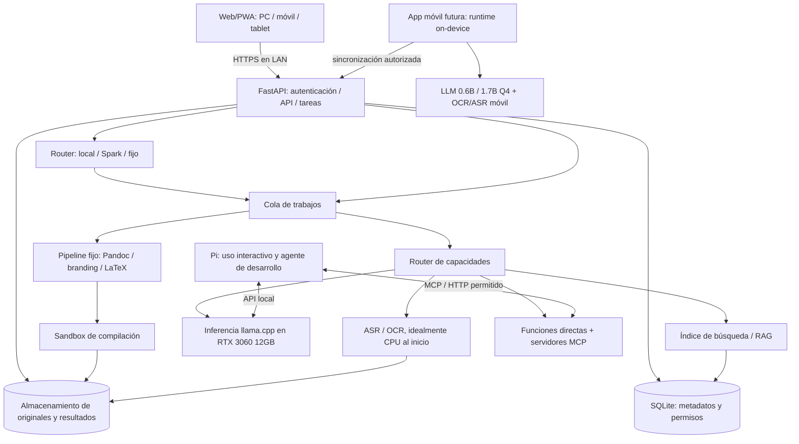

# ROSE NEXUS — Plan de producción

**Versión:** 0.2 (híbrida, con guía de arranque en Pi y servidor 3060)  
**Fecha:** 15 de noviembre de 2026  
**Estado:** Planificación; ninguna fase se considera implementada  
**Objetivo:** Construir una plataforma personal y local para transformar documentos, estudiar, comprender repositorios y mover información entre dispositivos.

> **Restricción de hardware confirmada:** La instancia de trabajo denominada «Spark» dispone de **una NVIDIA GeForce RTX 3060 con 12 GB de VRAM**. **NO** se presupone una NVIDIA DGX Spark ni 64/128 GB de memoria unificada. Todas las recomendaciones de IA de este documento se plantean para **12 GB de VRAM**. CPU, RAM, almacenamiento, sistema operativo, acceso remoto y versión exacta de Pi aún no están verificados.

---

## 1. Resumen ejecutivo

Rose Nexus será una **aplicación web responsive**, accesible desde computadora, teléfono y tablet por una red local autorizada. Su núcleo será un motor determinista capaz de recibir Markdown (`.md`) o texto (`.txt`), generar **LaTeX** aplicando el branding de una marca y compilar un **PDF** en un entorno controlado. Sobre ese núcleo se añadirán funciones de IA local y agentes.

La arquitectura será modular, pero **empezaremos con un único backend y un único frontend**. No crearemos microservicios ni multiagentes antes de necesitarlos. Lo básico debe funcionar **incluso con la IA apagada**.

### Objetivos de producto

1. **Rose Studio — obligatorio:** `.md/.txt → LaTeX → PDF` con identidad visual de la rama `Branding`, vista previa, exportación, errores comprensibles y sandbox.
2. **Rose Inbox / Connect — transversal:** subir desde móvil/tablet/escritorio a una bandeja central; envío dentro de la misma LAN como extensión posterior.
3. **Rose Learn — opcional y priorizable:** guardar clases, audio, imágenes, transcripciones, apuntes, materias, resúmenes y preguntas con referencias.
4. **Rose Dev — opcional y priorizable:** importar repositorios permitidos, extraer su estructura, explicar código, buscar símbolos y generar documentación.
5. **Agentes y automatización — transversal y progresivo:** usar Pi, MCP, Skills y routers donde realmente ayuden.

### Qué no haremos inicialmente

- No prometer inferencia on-device desde una web responsive: la web/PWA será cliente del servidor; para inferencia real y sin conexión en el teléfono/tablet se desarrollará un **cliente móvil con runtime nativo** y se verificará la memoria del dispositivo. Se incluye en el diseño desde el inicio, pero no bloquea el convertidor MVP.
- No usar un LLM para transformar Markdown básico, multiplicar números, listar archivos ni para compilar LaTeX.
- No cargar dos LLM grandes simultáneamente en una GPU de 12 GB.
- No abrir la API de inferencia directamente a internet.
- No ejecutar código de repositorios o LaTeX no confiable sin aislamiento.
- No implementar «agentes autónomos ilimitados» ni sincronización P2P compleja en la primera entrega.

### Decisión arquitectónica de la versión 0.2: IA híbrida

- **Capa 1 — dispositivo (on-device real, opcional en primera entrega):** modelo pequeño en **teléfono/tablet** para etiquetas, clasificación preliminar, limpieza simple de notas y respuestas cortas sin internet. OCR/ASR offline especializados cuando el hardware móvil lo permita. La captura, los archivos y las operaciones deterministas siguen funcionando aunque el LLM no esté cargado.
- **Capa 2 — instancia Spark (RTX 3060 12 GB):** modelo principal de 4B Q4 para resúmenes extensos, preguntas sobre apuntes con fuentes, comprensión de código y planificación con herramientas. Alternativa 8B probada por separado.
- **Capa 3 — backend Rose Nexus:** router de capacidad, privacidad y coste que **elige** entre código, dispositivo o Spark. Ni el móvil ni la IA pueden saltarse autorizaciones.
- **Sincronización:** crear trabajo local y sincronizar con el backend autorizado cuando haya conexión; cifrado en tránsito, idempotencia y separación de datos por espacios.
- **Límite honesto del MVP:** la UI web responsive no ejecutará automáticamente modelos nativos on-device. La versión móvil con inferencia local se creará como módulo propio después del convertidor, manteniendo la misma API y esquemas.

---

## 2. Principios de diseño

| Principio | Consecuencia operativa |
|---|---|
| **Offline-first cuando sea viable** | Conversión, archivos, OCR y LLM local; no depender de una API externa para el camino principal. |
| **Código para reglas fijas** | Pandoc/plantillas, validaciones, índices, hashing, colas y cálculos se resuelven con funciones convencionales. |
| **IA para lo ambiguo** | Explicar, resumir, clasificar casos inciertos, planear secuencias y responder preguntas. |
| **Un solo origen de verdad** | Archivos originales inmutables + metadatos/versiones; toda salida generada tiene procedencia. |
| **Permisos explícitos** | Espacios `personal`, `academico`, `empresa` aislados lógicamente; acciones sensibles requieren aprobación. |
| **Herramientas mínimas** | MCP solo si aporta interoperabilidad, compartición o límites claros; no envolver cada función en MCP. |
| **Medir antes de optimizar** | Registrar VRAM, latencia, tokens/s, calidad, errores y tiempo total de cada flujo. |
| **Flujos recuperables** | Trabajos largos en cola; estados `pendiente`, `ejecutando`, `completado`, `fallido`, `cancelado`. |

---

## 3. Producto y módulos

### M0. Base de la plataforma (P0)

- Usuarios locales, autenticación y sesiones; autorización por espacio.
- API y frontend responsive; subida controlada de archivos; biblioteca básica.
- Almacenamiento de originales y resultados; metadatos en SQLite.
- Cola de trabajos y eventos de progreso; logs por trabajo.
- Configuración de backend de inferencia, límites y espacio de disco.

**Criterio de salida:** desde teléfono en la LAN, un usuario autorizado sube un `.md`, ve el trabajo y descarga el resultado; otro usuario sin permiso no puede acceder al archivo.

### M1. Rose Studio — convertidor obligatorio (P0)

**Entrada:** `.md` o `.txt`, título, autor opcional, preset de branding, formato/salida.  
**Proceso:** normalizar → validar → convertir a LaTeX → renderizar plantilla de marca → compilar en sandbox → guardar `.tex`, `.pdf` y registro del trabajo.  
**Salida:** PDF, fuente LaTeX, errores útiles y procedencia del original.

**Subcomponentes:**

- `MarkdownParser` / normalizador (UTF-8, front matter, encabezados, imágenes y tablas).
- `BrandingResolver` (logo, colores, tipografías autorizadas, portada, encabezados, pie de página).
- `LatexGenerator` (Pandoc + plantilla; no pedir al LLM que reproduzca toda la sintaxis).
- `LatexCompiler` (motor de compilación invocado bajo políticas de sandbox).
- `ArtifactStore` (versiones y exportaciones).
- `DocumentPreview` (visor en web) y `JobReport` (errores, duración, archivos producidos).

**Integración de branding:** usar la **rama Git `Branding`** como fuente de requisitos/activos, una vez disponible. Registrar commit de origen; no asumir nombres de logos o colores sin examinarlos. Presets versionados dentro de `branding/`.

**Criterio de salida:** 10 documentos de prueba —títulos, tablas, código, imágenes, Unicode y texto largo— generan PDF/LaTeX; 0 invocaciones al LLM en conversión estándar; el PDF tiene el branding correcto; fallos se explican al usuario.

### M2. Rose Inbox / Connect (P1)

- Bandeja unificada: archivos, fotos, notas rápidas, URL, audio, fragmentos de texto.
- Acceso con navegador desde la misma LAN y almacenamiento central.
- Acciones rápidas: «guardar», «extraer texto», «transcribir», «crear documento», «enviar a otro dispositivo».
- Transferencia directa P2P, descubrimiento mDNS y emparejamiento como fase posterior, **no requisito del MVP**.

**Criterio de salida:** subir una foto desde móvil y recuperarla en PC sin servicios de terceros, bajo autenticación.

### M3. Rose Learn (P1/P2)

- Estructura curso → materia → clase → material.
- Subida de audio, imagen, diapositivas y notas.
- ASR (reconocimiento automático de voz): transcripción con timestamps; OCR: texto de imágenes.
- Resúmenes, lista de conceptos, tareas propuestas y preguntas de autoevaluación.
- Indexación y búsqueda; respuestas con referencias a archivo, clase, página o minuto.
- Exportación de apuntes al motor Studio.

**Criterio de salida:** una clase grabada produce transcripción consultable, resumen editable, referencias y PDF; el usuario puede corregir errores de ASR.

### M4. Rose Dev (P2)

- Importación de repositorios/carpetas autorizadas, preferentemente lectura solamente.
- Indexación determinista: árbol, lenguajes, manifiestos, imports, símbolos y búsquedas por texto.
- Recuperación de fragmentos relevantes; explicación de arquitectura y flujo del código.
- Resumen de cambios, documentación técnica y exportación al Studio.
- Espacios de la empresa estrictamente separados y sin sincronización externa sin autorización.

**Criterio de salida:** sobre un repositorio de prueba, explicar el punto de entrada y citar rutas/líneas correctas; nunca ejecutar scripts del repositorio para conseguirlo.

### M5. Automatizaciones y agentes (P2/P3)

- Flujos supervisados de varios pasos, con router, permisos, trazas y máximo de reintentos.
- Skills reutilizables para tareas documentales, académicas y de desarrollo.
- Integraciones MCP para exponer capacidades a Pi y otros clientes aprobados.
- Multiagentes especializados **solo después** de demostrar que un agente con herramientas no basta.

---

## 4. Arquitectura propuesta



**Despliegue inicial:** un monolito modular de Python + frontend web; un proceso independiente para `llama.cpp`; trabajadores que comparten una cola; almacenamiento local. Separar servicios solo cuando haya un motivo técnico medible.

### Responsabilidades bien delimitadas

- **Frontend web/PWA:** captura/visualización; nunca incorpora claves ni acceso directo al filesystem del servidor. **No equivale a IA on-device nativa.**
- **App móvil futura:** cache segura, runtime de inferencia nativa, cola offline y sincronización explícita; no envía datos de espacios privados a Spark sin autorización.
- **API/backend:** valida permisos, crea trabajos, registra eventos y resuelve rutas de entrada.
- **Motor de documentos:** transformación reproducible sin IA.
- **Router:** aplica primero reglas fijas por MIME/acción; cuando haya ambigüedad consulta al modelo.
- **LLM:** entiende solicitudes y produce salidas estructuradas para tareas semánticas.
- **Worker GPU:** agenda inferencia para no competir con ASR/OCR por VRAM.
- **MCP:** ofrece interfaces interoperables sobre funciones internas; cada solicitud vuelve a validar permisos.
- **Pi:** agente/entorno de experimentación e integración; no es requisito para abrir o convertir archivos en la web.

---

## 5. Estructura inicial del repositorio

```text
rose-nexus/
├── README.md
├── pyproject.toml                  # backend y herramientas Python
├── .env.example                    # nunca secretos reales
├── .gitignore
├── docker-compose.yml             # servicios controlados, cuando proceda
├── docs/
│   ├── production-plan.md         # copia versionada de este plan
│   ├── architecture.md
│   ├── decisions/                  # ADR-001, ADR-002...
│   ├── threat-model.md
│   ├── api-contracts.md
│   └── benchmarks/
├── apps/
│   ├── mobile/                     # futuro: cliente nativo y modelo on-device
│   │   └── README.md               # diseño solamente en MVP
│   └── web/                        # React/Vite (opción inicial)
│       ├── src/pages/
│       ├── src/components/
│       └── src/lib/api/
├── backend/
│   └── rose_nexus/
│       ├── main.py                 # FastAPI
│       ├── api/                    # rutas HTTP
│       ├── auth/                   # usuarios, roles, tokens/sesiones
│       ├── core/                   # configuración, errores, eventos
│       ├── db/                     # modelos, migraciones, repositorios
│       ├── jobs/                   # cola, estados, workers
│       ├── storage/                # archivos, metadatos y hashing
│       ├── studio/
│       │   ├── parser.py
│       │   ├── convert.py
│       │   ├── branding.py
│       │   └── compiler.py
│       ├── inbox/
│       ├── learn/
│       │   ├── transcribe.py
│       │   ├── ocr.py
│       │   ├── index.py
│       │   └── summarize.py
│       ├── dev/
│       │   ├── repo_reader.py
│       │   ├── code_index.py
│       │   └── explain.py
│       ├── ai/
│       │   ├── llm_client.py
│       │   ├── model_registry.py
│       │   ├── prompts.py
│       │   └── router.py
│       ├── security/
│       │   ├── policies.py
│       │   ├── approvals.py
│       │   └── sandbox.py
│       └── observability/
│           ├── events.py
│           └── metrics.py
├── mcp-servers/
│   ├── rose-documents/            # servidor STDIO inicial
│   ├── rose-library/              # servidor STDIO inicial
│   ├── rose-repositories/         # lectura, fase posterior
│   └── rose-http-gateway/         # opcional para clientes remotos
├── skills/
│   ├── document-authoring/SKILL.md
│   ├── study-session/SKILL.md
│   ├── repository-explainer/SKILL.md
│   └── safe-workflow/SKILL.md
├── branding/
│   ├── profiles/                   # brand.json o YAML aprobado
│   ├── templates/                  # plantillas Pandoc / LaTeX
│   ├── assets/                     # logos/autorizaciones
│   └── fonts/                      # solamente fuentes con licencia
├── models/
│   └── README.md                   # referencias y checksums; NO GGUF en Git
├── tests/
│   ├── fixtures/                   # MD, TXT, LaTeX, audio, imágenes
│   ├── unit/
│   ├── integration/
│   ├── mcp-contract/
│   ├── llm-evals/
│   ├── security/
│   └── e2e/
└── scripts/
    ├── doctor.sh                   # nvidia-smi, versiones, dependencias
    ├── benchmark-llm.sh
    └── verify-build.sh
```

**Notas:** la estructura es un objetivo de organización, no una invitación a crear carpetas vacías desde el primer día. Al arrancar solo se materializan M0/M1, `tests`, `branding` y documentación. La carpeta `models/` no guardará modelos grandes en Git.

---

## 6. Funciones directas, MCP y Skills

### 6.1 Matriz de capacidades

| Capacidad | Tipo principal | ¿Por qué? | Fase |
|---|---|---|---|
| Validar extensión, MIME, tamaño, permisos | **Función directa** | Determinista y de seguridad | P0 |
| Parsear Markdown/TXT y generar LaTeX | **Función directa** | Reproducibilidad, pruebas | P0 |
| Aplicar branding | **Función directa** | Plantilla versionada, no creatividad del modelo | P0 |
| Compilar LaTeX en sandbox | **Worker/función** | Operación restringida, no decisión del modelo | P0 |
| Consultar biblioteca de documentos | **Función + MCP de lectura** | Compartible entre Pi y Rose Nexus | P1 |
| Guardar/classificar contenido de bandeja | **Función + MCP controlado** | Persistencia y reutilización | P1 |
| Transcribir audio | **Función/worker ASR** | Modelo especializado, no LLM generalista | P1 |
| Extraer texto OCR | **Función/worker OCR** | Modelo especializado | P1 |
| Resumir una clase / generar preguntas | **LLM + Skill** | Semántica y procedimiento; Spark para documentos largos | P1 |
| Etiquetar nota breve sin conexión | **LLM móvil** (si instalado) | 0.6B/1.7B para clasificación con revisión | P2 |
| Buscar fragmentos relevantes (RAG) | **Funciones de indexado + MCP read-only** | Recuperación medible | P1 |
| Examinar árbol y símbolos de repositorio | **Funciones directas** | Datos objetivos, sin ejecutar proyecto | P2 |
| Explicar arquitectura de software | **LLM + Skill + funciones lectura** | Razonamiento apoyado en fuentes | P2 |
| Crear documentación de un repo | **LLM + Skill + Studio** | Procedimiento repetible + contenido variable | P2 |
| Enviar un archivo entre dispositivos | **Función/API** | Transferencia determinista; MCP opcional | P1/P3 |
| Seleccionar dispositivo vs. Spark | **Router fijo + política** | Reglas por conectividad, RAM, privacidad y tamaño; LLM no controla permisos | P2 |
| Borrar/modificar/enviar datos externos | **Acción protegida** | Requiere reglas y aprobación humana | P3 |

### 6.2 Servidores MCP propuestos

**A. `rose-documents` — STDIO, proyecto local, prioridad alta**  
Herramientas sugeridas (descripciones precisas y esquema JSON tipado):

- `render_document(source_id, branding_profile, output_format)` — crea trabajo de compilación controlado.
- `get_document_status(job_id)` — consulta estado, errores y artefactos.
- `list_branding_profiles()` — lista perfiles autorizados.
- `get_document_metadata(document_id)` — devuelve metadatos.

**B. `rose-library` — STDIO, solo lectura por defecto, prioridad media**

- `search_documents(query, space, limit)` — retorna fragmentos breves con IDs y procedencia.
- `get_document_excerpt(document_id, section_id)` — devuelve solo rango autorizado.
- `list_courses()` y `list_sessions(course_id)` — navegación académica.
- `save_note(...)` — **acción de escritura protegida**, no expuesta al principio.

**C. `rose-repositories` — STDIO, read-only, prioridad media/tardía**

- `list_repo_files(repo_id, filter)`.
- `search_code(repo_id, query, limit)`.
- `read_code_excerpt(repo_id, path, start_line, end_line)`.
- `get_repo_map(repo_id)`.

**D. `rose-http-gateway` — Streamable HTTP, prioridad baja**  
Solo si necesitamos un cliente MCP fuera del mismo host. Proteger con autenticación, TLS, controles de usuario y auditoría. **No exponer de inicio por WAN**.

**Exposición a Pi:** empezar con pocas herramientas esenciales `direct`; indexadores y herramientas grandes como `deferred`/`codemode` si la versión instalada de Pi lo soporta; las destructivas deshabilitadas/ocultas. Confirmar con `pi mcp --help` y `/mcp`.

**Diseño de las herramientas:** nombres inequívocos, descripciones cortas, `required` correctos, enums cuando aplique, límites de longitud, salidas compactas, `job_id` para procesos largos, `error_code` estable. Ningún servidor debe confiar en rutas arbitrarias o en un `user_id` declarado libremente por el modelo.

### 6.3 Skills propuestas (archivos de instrucciones/procedimientos)

1. **`document-authoring`**: preguntas mínimas → elección de preset → revisión de estructura → creación/conversión → comprobación visual → enlace del PDF.
2. **`study-session`**: ingestión → transcripción/OCR → separa hechos de inferencias → resumen con referencias → conceptos → dudas → guía de estudio.
3. **`repository-explainer`**: inspección sin ejecutar → mapa de archivos → identificación de puntos de entrada → recuperación puntual → explicación citando archivos y líneas.
4. **`safe-workflow`**: política transversal de acciones sensibles, permisos, datos no confiables, aprobación, redacción y límites.

Las Skills no sustituyen un sandbox ni autorizaciones a nivel de API. Los `.md` y `SKILL.md` de terceros son **datos no confiables** hasta revisarlos.

---

## 7. Fijo vs. variable: frontera entre código e IA

| Actividad | Fijo / variable | Ejecutor | Evidencia de éxito |
|---|---|---|---|
| Detectar tipo de archivo | Fijo | MIME + validación | Tipo correcto o rechazo |
| MD → estructura → LaTeX | Fijo | Pandoc/plantillas | PDF comparable, tests |
| Colores, tipografías y márgenes | Fijo | Perfil `Branding` | Identidad visual consistente |
| Compilar documento | Fijo | Compilador sandbox | Código de salida y artefactos |
| OCR y ASR | ML especializado | PaddleOCR / faster-whisper | Calidad frente a muestras verificadas |
| Detectar idioma | Semifijo / ML | Detector ASR o librería | Probabilidad / revisión |
| Resumir clase | Variable | LLM con fuentes | Fidelidad, citas y legibilidad |
| Relacionar clases distintas | Variable | RAG + LLM | Referencias verdaderas |
| Calcular tareas/fechas estructuradas | Mixto | LLM extrae; código valida | Fechas y estados consistentes |
| Recorrer archivos / calcular hashes | Fijo | Código | Salida exacta |
| Explicar por qué existe una función | Variable | LLM + fragmentos | Explicación verificable |
| Elegir herramienta con input explícito | Fijo | Router con reglas | Rutas reproducibles |
| Elegir flujo cuando la petición es ambigua | Variable | LLM en JSON restringido | Selección correcta en evaluación |

**Router en dos niveles:** (1) reglas deterministas por acción/tipo/espacio; (2) si no alcanza, clasificador LLM con destinos permitidos, sin ejecución directa. El backend valida la decisión y sus permisos antes de llamar herramientas.

---

## 8. Modelo local y eficiencia para RTX 3060 de 12 GB

### 8.1 Estrategia recomendada

**Modelo principal de arranque en Spark/RTX 3060:** **Qwen3-4B-Instruct-2507**, GGUF **Q4_K_M**. Provee un equilibrio inicial entre calidad, VRAM y oportunidad de ejecutar tareas pequeñas; la versión `Instruct-2507` es **non-thinking**, lo que evita gastar tokens de razonamiento oculto en tareas sencillas. Verificar tool calling sobre nuestra propia batería de pruebas, no asumir que será infalible.

**Segundo candidato para tareas más difíciles:** **Qwen3-8B**, GGUF **Q4_K_M**. Ocupa más memoria; cargarlo **en lugar del 4B**, no simultáneamente. Probar resúmenes y selección de herramientas con contexto 8K antes de subirlo. El Qwen3-8B original admite thinking y non-thinking; escoger según presupuesto y comportamiento observado.

**Candidato orientado a código (solo si supera al anterior):** **Qwen2.5-Coder-7B-Instruct** en **Q4_K_M**. No elegirlo por su nombre sin comparar tareas reales de repositorios.

| Perfil | Modelo / cuantización | Peso GGUF orientativo | Uso | Estado |
|---|---|---:|---|---|
| Ligero (predeterminado) | Qwen3-4B-Instruct-2507 Q4_K_M | ~2.5 GB | Chat, resumen corto, extracción, routing | Probar primero |
| General más potente | Qwen3-8B Q4_K_M | ~5.0 GB | Resumen complejo, explicación y herramientas | Benchmark A/B |
| Especializado código | Qwen2.5-Coder-7B-Instruct Q4_K_M | ~4.7 GB | Explicar repositorios | Benchmark opcional |

**Interpretación:** son tamaños aproximados de **archivos de pesos**, **NO** VRAM total. A ellos se suman caché KV, buffers, atención, reservas del driver y otros procesos. No hemos medido tu instancia concreta. Con 12 GB debe evitarse la falsa sensación de que un archivo GGUF de 5 GB solo utiliza 5 GB de GPU.

### 8.2 Cuantización

- **Q4_K_M como punto de partida**, no 2 bits. El costo de calidad al bajar a Q2 puede ser importante, sobre todo en seguimiento de instrucciones, JSON y llamadas de herramientas.
- Evaluar Q5_K_M si hay holgura y mejora observable; probar Q3 únicamente si memoria/latencia obligan.
- **No confundir** cuantización de pesos con **precisión de caché KV**: se configuran por separado.

### 8.3 Comando inicial reproducible

Con la distribución oficial `llama` para Linux, tras comprobar versión y CUDA:

```bash
# Solo una instancia de modelo a la vez; inferencia no expuesta a la LAN
llama serve \
  -hf unsloth/Qwen3-4B-Instruct-2507-GGUF:Q4_K_M \
  --host 127.0.0.1 --port 8080 \
  --ctx-size 8192 \
  --parallel 1 \
  --n-gpu-layers all \
  --flash-attn on \
  --cache-type-k f16 \
  --cache-type-v f16
```

**Nota de compatibilidad:** en algunas instalaciones el binario se llama `llama-server` y el subcomando `serve` no existe; verificar `llama --help` / `llama-server --help`. El enlace oficial de instalación de la distribución `llama` es `https://llama.app/install.sh`; **inspeccionar cualquier script de instalación antes de ejecutarlo**. Este comando requiere backend CUDA funcional. Ajustar flags a la versión realmente instalada.

**Variación de benchmark 8B (no simultánea):**

```bash
llama serve \
  -hf unsloth/Qwen3-8B-GGUF:Q4_K_M \
  --host 127.0.0.1 --port 8080 \
  --ctx-size 8192 \
  --parallel 1 \
  --n-gpu-layers all \
  --flash-attn on \
  --cache-type-k f16 --cache-type-v f16
```

### 8.4 Parámetros iniciales y experimentos

| Ajuste | Inicial | Motivo / regla de ajuste |
|---|---|---|
| `ctx-size` | **8192** | Establecer una base; subir a 16384 solo si hay necesidad y VRAM disponible. |
| `parallel` / slots | **1** | Minimizar caché/competencia y simplificar el primer benchmark. |
| `n-gpu-layers` | **all** | Evitar CPU offload si cabe; en OOM bajar contexto o modelo primero. |
| Flash Attention | **on** si soportado | Medir beneficio en prefill/contexto y confirmar backend. |
| KV cache | **f16 inicialmente** | Mejor referencia de calidad y compatibilidad. Experimentar después `q8_0` en K/V y validar resultados. |
| Output por petición | **1024–2048 tokens** | Evitar respuestas innecesariamente extensas; trabajos largos en secciones. |
| Herramientas declaradas | **3–6 relevantes** | No llenar contexto con 30 definiciones. |
| Temperature herramientas | **0–0.2 orientativa** | Reducir variación, validar JSON y schema; comparar con config específica del modelo. |
| Temperature redacción | **0.3–0.6 orientativa** | Más fluidez sin perder referencias; medir fidelidad. |
| Concurrencia GPU | **1 trabajo pesado** | No ejecutar ASR grande + LLM 8B simultáneamente sin medir VRAM. |
| Historial/contexto | Resumir o recuperar | No adjuntar repositorios/clases completos a cada prompt. |

**Importante:** el número de tokens del modelo no «da más nivel» automáticamente a una herramienta MCP. Contexto, cuantización, estructura del schema y calidad de selección de tools se prueban independientemente.

### 8.5 OCR, ASR y embeddings sin saturar la GPU

- **ASR:** empezar con `faster-whisper` `small` (o `base` si el rendimiento lo exige) y evaluar `int8` en CPU; medir el español real de clases. Si se usa CUDA, cambiar a `int8_float16`/`float16` según compatibilidad y ejecutar **por turnos** con el LLM.
- **OCR:** comenzar con PaddleOCR (modelo pequeño); preferir CPU al arrancar y valorar GPU solo tras medir. Para documentos PDF con texto existente, **extraer texto nativo antes de hacer OCR**.
- **Embeddings:** usar un encoder multilingüe ligero en CPU al principio; ejemplo a evaluar `intfloat/multilingual-e5-small`. Guardar el ID de modelo y dimensión para evitar índices incompatibles.
- **RAG:** indexación fragmentada por títulos/minutos/símbolos, almacenamiento de `source_id`, `offset`, página/línea y etiquetas de espacio. Recuperar 3–6 fragmentos; no introducir libros completos al contexto del LLM.
- **GPU scheduler:** gestionar memoria y colas; descargar modelo o serializar servicios para evitar OOM.

### 8.6 Modelos pequeños en teléfono/tablet (inferencia on-device real)

La elección final depende del sistema operativo, RAM disponible, CPU/NPU/GPU, restricciones térmicas y batería de **cada dispositivo**. Por tanto, estos son **candidatos**, no una promesa de compatibilidad o velocidad:

| Perfil | Modelo GGUF candidato | Tamaño de archivo Q4_K_M aproximado | Uso sugerido | Criterio de habilitación |
|---|---|---:|---|---|
| Móvil muy liviano | **Qwen3-0.6B Q4_K_M** | ~0.48 GB | Clasificar, etiquetar y reescribir frases muy cortas | Respuesta razonable + memoria/temperatura tolerables |
| Móvil con más RAM | **Qwen3-1.7B Q4_K_M** | ~1.28 GB | Extracción estructurada sencilla, notas cortas | Superar calidad de 0.6B sin degradar UX |
| Tareas complejas | **Qwen3-4B-Instruct-2507 Q4_K_M en RTX 3060** | ~2.5 GB | Resúmenes extensos, explicar código, MCP/skills | Conectividad autorizada y benchmark |

Los tamaños indicados **son del archivo, no del consumo total en RAM**; requieren recursos adicionales para runtime y KV. Un modelo de 0.6B no debe decidir acciones destructivas, autorizar accesos ni producir sin verificación análisis académicos importantes. No usar 2 bits como supuesto de rendimiento óptimo.

**Runtime móvil futuro:** evaluar `llama.cpp` integrado de forma nativa en Android/iOS (o un framework móvil compatible), **no** suponer que abrir Rose Nexus en un navegador activa inferencia offline. El ASR móvil puede explorar `whisper.cpp` tiny/base, y OCR APIs nativas o motor móvil optimizado tras benchmarks. Guardar `model_version`, origen del resultado y capacidad utilizada.

**Router de tres destinos, en este orden:**

1. **Código fijo:** conversión, hashing, transferencias, validación, búsqueda exacta, aplicación del branding.
2. **On-device:** si app nativa instalada, recursos disponibles y tarea pequeña; privacidad/offline preferente. Si no hay modelo, usar reglas/código o guardar pendiente.
3. **Spark:** si el trabajo requiere más calidad/contexto, existe conexión autenticada y el usuario/espacio permite transferir ese contenido; trabajos largos pasan a una cola.

**Ejemplos:** captura breve en el teléfono → etiquetar localmente; audio largo de clase → guardar local y transcribir al conectar (sin pretender que 0.6B sea un ASR); PDF con branding → motor fijo en backend; análisis de repo → indexar con código y explicar con Spark.

**Sincronización y privacidad:** transferencia cifrada, autenticación por dispositivo, emparejamiento y revocación, IDs estables de archivos, checksums, conflictos resueltos con versiones; nunca mezclar espacio `empresa` y `personal` sin permiso. Un dato de empresa **no** se envía automáticamente a Spark por estar en LAN; requiere autorización explícita de la organización.

### 8.7 Benchmark obligatorio en la instancia real

Primero ejecutar:

```bash
nvidia-smi
free -h
uname -a
llama --version  # o llama-server --version
```

Registrar además versión del driver, CUDA visible, uso base de VRAM, RAM, CPU, disco libre y limitaciones de la instancia Spark. Medir por modelo:

1. Pico VRAM y tiempo de carga con contexto 4096/8192/16384.
2. Tokens/s de prefill y generación (3 ejecuciones, misma pregunta).
3. Porcentaje de JSON válido y selección correcta de herramientas.
4. Exactitud factual en español, resúmenes con citas y explicación de código.
5. Tasa de alucinaciones, tiempo a primer token y respuestas erróneas ante instrucciones inyectadas.
6. Concurrencia/competencia con OCR o ASR; definir un máximo de recursos en producción.

**Regla de promoción:** un modelo más grande solo sustituye al predeterminado si mejora claramente las evaluaciones definidas **sin** sacrificar disponibilidad y latencia de manera inaceptable.

---

## 9. Pipeline de documentos y branding

```text
Usuario sube .md/.txt
  → comprobar autenticación y permisos
  → validar tamaño, tipo y contenido
  → guardar original inmutable
  → normalizar Markdown y metadatos
  → seleccionar branding autorizado
  → Pandoc genera LaTeX con plantilla
  → sandbox compila LaTeX (sin shell-escape)
  → verificar PDF, recolectar logs
  → guardar .tex/.pdf + checksum + estado
  → permitir vista previa y descarga
```

**Tecnologías candidatas:** Pandoc para AST y conversión, plantilla LaTeX versionada, TeX Live/XeLaTeX para compatibilidad tipográfica o Tectonic si satisface los requisitos de fuentes/paquetes. Elegir compilador tras experimentar con la rama `Branding`.

**Reglas de seguridad de la tubería:**

- Escapar/normalizar contenido y **no aceptar LaTeX crudo** de usuarios no confiables por defecto.
- Prohibir `shell-escape`, paquetes/ejecución externa no autorizados y referencias a rutas arbitrarias.
- Compilar en contenedor/proceso restringido con usuario no root, filesystem raíz de solo lectura, directorio de trabajo efímero, sin red, límites de CPU, RAM, tiempo y tamaño del PDF.
- Tener TeX y assets permitidos preinstalados para no depender de descargar paquetes durante el job.
- Validar rutas canónicas, symlinks, `..`, rutas absolutas y tamaño de assets; una comprobación textual aislada no basta.
- Aplicar máxima cantidad de reintentos (por ejemplo, 1 corrección automática controlada, sin ejecución arbitraria).

**Branded templates:** definir esquema `BrandProfile` con `name`, `version`, `logo_id`, `colors`, `font_family`, `page_size`, `cover_style`, `footer`, `watermark` y rutas autorizadas; probar ejemplos del branding con inspección visual.

---

## 10. Seguridad y privacidad

### 10.1 Niveles de confianza

- `personal`: archivos propios, sin acceso de otras cuentas.
- `academico`: clases y materiales con control de uso y consentimiento para grabaciones.
- `empresa`: repositorios internos; permisos separables, no mezclarlos con búsqueda personal por defecto.
- `untrusted_uploads`: entrada no ejecutable hasta ser validada/sanitizada.

### 10.2 Controles mínimos

1. **Mínimo privilegio:** MCP de lectura salvo autorización expresa, rutas autorizadas y usuarios separados.
2. **Sandbox de compilación:** sin red, sin shell-escape, límites de recursos, archivos temporales aislados.
3. **Aprobación humana:** borrar, sobrescribir, compartir externamente, ejecutar código, enviar secretos y modificar un repo.
4. **Límites de ciclo:** por sesión/workflow: número de tools, tiempo, reintentos, bytes y presupuesto de tokens.
5. **Entrada no confiable:** PDFs, MD, transcripciones y archivos `SKILL.md` se consideran contenido, no instrucciones del sistema.
6. **Acceso desde LAN:** autenticación, emparejamiento si aplica, HTTPS/TLS cuando sea viable, CSRF/CORS y expiración de sesión. **LAN no equivale a red confiable.**
7. **Inferencia aislada:** `llama` en `127.0.0.1`; solo el backend autenticado consulta su API.
8. **Auditoría:** quién solicitó qué, espacio, acción, resultado y hora; evitar almacenar datos sensibles completos en logs.
9. **Copia de seguridad:** metadata y originales, cifrado si se almacenan contenidos sensibles, restauración ensayada.
10. **Retención:** controles de borrar originales/transcripciones/índices y archivos temporales.

### 10.3 Modelo de amenazas simplificado

| Riesgo | Ejemplo | Mitigación |
|---|---|---|
| Prompt injection | Markdown ordena ignorar políticas | Separar datos/instrucciones y validar tools |
| Path traversal | `../../.ssh/id_rsa` | IDs de archivo, rutas canonizadas y sandbox |
| Escape desde LaTeX | Compilación inicia procesos | Sin shell-escape + aislamiento OS |
| Exfiltración de código | Repo interno se envía a web externa | Sin red por defecto, espacios, aprobación |
| GPU OOM | 8B + ASR heavy compiten | Cola GPU y límites de VRAM/concurrencia |
| Abuso LAN | Dispositivo no autorizado consulta biblioteca | Auth, TLS, roles, rate limits |
| Inyección por dependencia | MCP/npm desconocido ejecuta código | Versiones fijadas, auditoría y mínimo privilegio |

---

## 11. Observabilidad y pruebas

### Tres niveles

- **Protocolo:** MCP Inspector para inspeccionar contrato, herramientas, argumentos y errores.
- **Agente:** eventos/trazas de Pi y del orquestador: elección de tool, argumentos seguros, duración, resultado.
- **Sistema:** logs estructurados, métricas y OpenTelemetry **después** de contar con el MVP; monitorizar GPU, RAM, cola, tiempo de compilación, tasa de éxito y latencia.

### Cuatro pruebas fundamentales

1. **Contrato:** esquema JSON, tipos, límites, permisos y errores estructurados de cada herramienta.
2. **Modelo:** ¿elige tool correcta?, ¿construye argumentos?, ¿hace abstención cuando faltan datos?, ¿resiste prompt injection?
3. **Protocolo:** STDIO/HTTP, conexión, inicialización, reconexión, timeouts, errores y cancelaciones.
4. **Código fijo:** conversiones de documentos, paths, hashing, tiempos, extracción, compile reproducible y branding.

### Pruebas adicionales

- **E2E:** subir desde móvil → convertir → descargar PDF.
- **Visuales:** inspección de portada, tablas, código, márgenes, fuentes y logos.
- **Seguridad:** DOC malicioso, enlaces a rutas externas, imágenes enormes, zip-bombs, LaTeX inseguro, exceso de carga.
- **Calidad ASR/OCR:** corpus breve en español con verdad de referencia; medir errores antes de activar extracción automática de tareas.
- **RAG:** respuestas con referencias correctas; si el dato no aparece, decir «no encontrado».
- **Repos:** explicar sin ejecutar y sin mezclar repositorios privados entre espacios.

---

## 12. Plan de producción por entregables

Estimaciones **relativas**, no fechas comprometidas. Un bloque indica un hito que se puede demostrar. Los módulos opcionales se priorizarán después; no es necesario decidir ahora cuál desarrollar primero.

| Hito | Prioridad | Implementar | Evidencia para cerrar |
|---|---|---|---|
| **H0 — Discovery / baseline** | P0 | Confirmar instancia, RAM/OS, Spark, Pi, compilers, branding; benchmark 4B/8B. | Registro de hardware, prueba llama.cpp, ADR-001. |
| **H1 — Conversor CLI** | P0 | MD/TXT → LaTeX/PDF, branding, sandbox, fixtures. | CLI reproducible + 10 PDFs comparados. |
| **H2 — Aplicación web MVP** | P0 | API, frontend, auth mínima, upload, jobs, preview, export. | Demo en PC y teléfono LAN. |
| **H3 — Integración agente/MCP** | P1 | `rose-documents`, Pi, tool contract, límites, trazas. | El agente solicita generación y recibe `job_id`; tests pasan. |
| **H4 — Inbox y archivos** | P1 | Biblioteca, subida móvil, recolección y etiquetas. | Mismo archivo disponible en 2 dispositivos autorizados. |
| **H5 — Primer flujo inteligente** | P1 | Elegir Learn **o** Dev con benchmarks. | Un caso completo con referencias y PDF. |
| **H6 — Segundo flujo inteligente** | P2 | Agregar el flujo restante; indexación común. | Pruebas de calidad por dominio. |
| **H7 — Productividad LAN avanzada** | P2 | Transferencia dirigida, emparejamiento, OCR/ASR fluido. | Prueba entre dispositivos y permisos. |
| **H7b — App móvil on-device** | P2 | Runtime nativo, modelos Q4 pequeños, cola offline y sincronización segura. | En modo avión clasifica notas locales y luego sincroniza con autorización. |
| **H8 — Endurecimiento/release** | P1 transversal | Seguridad, backups, E2E, rendimiento, empaquetado, manual. | Release candidate instalable, demo, documentación. |

### Orden recomendado para H0–H2 (tareas muy concretas)

- [ ] Confirmar `nvidia-smi`, RAM, CPU, driver, OS, Docker/Podman, dependencias.
- [ ] Comprobar versión de Pi, `llama` y su configuración; registrar comandos realmente compatibles.
- [ ] Obtener y examinar rama `Branding`: logos, fuentes, paleta, ejemplos y licencias.
- [ ] Definir 10 documentos de prueba con entradas/salidas esperadas.
- [ ] Crear CLI Python `rose convert archivo.md --brand marca --out salida/`.
- [ ] Implementar generación LaTeX sin modelo; compilar en sandbox con timeout y logs.
- [ ] Crear suite de tests de Markdown, branding y seguridad.
- [ ] Montar API y UI para subir, ver progreso y descargar `.pdf` y `.tex`.
- [ ] Medir tiempos por documento y publicar una demo reproducible.

### Condición de la entrega mínima (Definition of Done)

Una persona autorizada puede, sin conocimientos de LaTeX, subir un `.md` desde su navegador y obtener un PDF correcto con la marca; también puede descargar el `.tex`; el sistema conserva el original, muestra errores de compilación comprensibles, no necesita LLM para convertir y no concede acceso arbitrario al servidor.

---

## 13. Métricas objetivo (hipótesis para validar)

Son **objetivos de ingeniería**, no resultados medidos:

| Métrica | Objetivo inicial | Cómo comprobar |
|---|---|---|
| Conversión documentos de prueba | ≥ 95% correctos en fixtures; 100% antes de release del conjunto de referencia | CI / inspección visual |
| Disponibilidad del conversor sin IA | 100% de funciones base accesibles con LLM detenido | Prueba de modo offline |
| Herramientas: JSON válido | ≥ 95% en dataset de evaluación | 50+ prompts representativos |
| Selección correcta de herramienta | ≥ 90% al inicio, mejorar con schemas/router | Matriz de test |
| Seguridad: acceso entre espacios | 0 fugas en casos de prueba | Tests de autorización |
| Respuestas basadas en fuentes | Citar documentos/rutas/minutos con trazabilidad | Evaluación manual |
| Latencia de inferencia | Medir y definir umbral tras H0 | Tests repetidos en RTX 3060 |
| Pico VRAM | Por debajo de 12 GB con margen para driver | `nvidia-smi` y logs |
| UX móvil | Subida y descarga utilizables en tablet/teléfono | Prueba en dispositivo físico |

---

## 14. Riesgos y mitigaciones

| Riesgo | Impacto | Respuesta |
|---|---|---|
| 12 GB de VRAM insuficientes para varios modelos | OOM, lentitud | 4B Q4 predeterminado, cola GPU, CPU ASR/OCR, 8B solo a demanda |
| Calidad LLM pequeña en tool calling | Acciones erróneas | Router fijo + schemas + tests + permisos; no depender solo de modelo |
| Compilación LaTeX insegura | Explotación de archivos | Sandbox, listas blancas, no shell-escape, tests ofensivos |
| Fuentes/branding no disponibles | Bloqueo de UI y PDFs | H0 inspeccionar rama Branding, assets/licencias; fallback documentado |
| Expansión de alcance | MVP nunca termina | H1–H2 obligatorios antes de Learn/Dev/Connect avanzados |
| Clases con ruido/audio extenso | ASR poco confiable | Guardar audio, timestamps, corrección manual, evaluación en español |
| Repositorios grandes | Contexto agotado | Índices, búsqueda, chunking y recuperación selectiva |
| Restricciones de uso de código corporativo | Riesgo legal o de privacidad | Aprobaciones, sin nube, espacio aislado, auditoría |

---

## 15. Decisiones registradas y pendientes

### Decidido para v0.2

- **Hardware:** RTX 3060 con **12 GB VRAM** en la instancia Spark del usuario.
- **Prioridad contractual:** converter `.md/.txt → .tex → .pdf` con rama `Branding`.
- **UI:** web responsive primero; **cliente móvil con inferencia nativa on-device** como módulo posterior ya aceptado; las interfaces comparten contratos, pero no hay falsas promesas de offline en navegador.
- **Backend:** Python + FastAPI como propuesta inicial; revisar solo si mediciones justifican Rust/Java.
- **Arquitectura:** monolito modular, operaciones deterministas separadas de razonamiento.
- **LLM Spark:** Qwen3-4B-Instruct-2507 Q4_K_M; benchmark Qwen3-8B Q4_K_M. **LLM móvil:** Qwen3-0.6B/1.7B Q4_K_M según hardware real.
- **MCP:** empezar con STDIO de documentos; HTTP remoto solo si hace falta.
- **Privacidad:** modelo local, espacios segregados y no ejecución arbitraria.

### Pendiente de verificar / decidir

- [ ] Qué significa exactamente «Spark» en el despliegue del usuario y cómo está expuesta la instancia.
- [ ] OS, CPU, RAM, disco, driver/CUDA, acceso root y restricciones de Docker/Podman.
- [ ] ¿Pi instalado? ¿Qué versión? ¿Qué soporte MCP/SDK/RPC exacto?
- [ ] ¿Cuál es el repositorio y rama `Branding` y quién aprueba su uso?
- [ ] ¿Necesitamos cumplir una fecha académica o una demostración concreta?
- [ ] ¿Qué tamaños y duraciones de audio/archivos soportar en el MVP?
- [ ] Modelos exactos de teléfono/tablet, OS y RAM para probar on-device.
- [ ] ¿Solo una cuenta personal o varias cuentas?
- [ ] ¿Espacios de empresa permitidos en esta infraestructura?
- [ ] ¿Priorizar Learn, Dev o Connect tras convertir? **Se decidirá después, según petición del usuario.**
- [ ] Elegir compilador final, índices, motor de colas y formato de backup mediante pruebas.

---

## 16. Referencias para verificar en la implementación

Consultadas o contrastadas al preparar este plan (15 nov 2026). Las recomendaciones son **hipótesis técnicas** sujetas a cambios de versión:

- `llama.cpp` servidor y flags: https://github.com/ggml-org/llama.cpp/blob/master/tools/server/README.md
- Modelo Qwen3-4B-Instruct-2507 (oficial): https://huggingface.co/Qwen/Qwen3-4B-Instruct-2507
- GGUF Qwen3-4B-Instruct-2507: https://huggingface.co/unsloth/Qwen3-4B-Instruct-2507-GGUF
- Qwen3-0.6B GGUF: https://huggingface.co/tensorblock/Qwen_Qwen3-0.6B-GGUF
- Qwen3-1.7B GGUF: https://huggingface.co/tensorblock/Qwen_Qwen3-1.7B-GGUF
- Modelo Qwen3-8B (oficial): https://huggingface.co/Qwen/Qwen3-8B
- GGUF Qwen3-8B: https://huggingface.co/unsloth/Qwen3-8B-GGUF
- Modelo para código Qwen2.5-Coder-7B: https://huggingface.co/Qwen/Qwen2.5-Coder-7B-Instruct-GGUF
- `whisper.cpp` (iOS/Android): https://github.com/ggml-org/whisper.cpp
- `faster-whisper`: https://github.com/SYSTRAN/faster-whisper
- PaddleOCR: https://github.com/PaddlePaddle/PaddleOCR
- Pandoc: https://pandoc.org/MANUAL.html
- MCP: https://modelcontextprotocol.io/
- MCP Inspector: https://github.com/modelcontextprotocol/inspector
- Pi MCP (la implementación exacta depende de la distribución instalada): https://github.com/agentdevhub/Pi/blob/main/packages/coding-agent/docs/mcp.md
- OpenTelemetry: https://opentelemetry.io/docs/

---

## 17. Próximo trabajo concreto

**Ejecutar H0.** No comenzar por prompts extensos, OCR o multiagentes. Primero verificar el entorno de la RTX 3060 de 12 GB, elegir un modelo realmente usable, inspeccionar el branding y crear un prototipo pequeño y seguro de Markdown → LaTeX → PDF. El requisito obligatorio seguirá funcionando aunque el componente de IA falle.

**Revisión del plan:** luego de H0, actualizar a versión 0.3 con hardware real, comandos verificados, benchmarks, estructura de base de datos y decisiones de branding. Evitar convertir supuestos en hechos.


---

## 18. Guía de arranque: dos pistas paralelas (Pi y RTX 3060)

**No ejecutar los siguientes pasos en producción ni exponer una instancia pública.** Se trata del baseline de desarrollo; verificar sistema operativo, permisos y versiones. Primero crear repo y prueba de convertidor; simultáneamente configurar inferencia. Los dos caminos se juntan recién después de que ambos pasan sus pruebas.

### Pista A — Desarrollo en tu PC, con Pi (H0 + H1)

1. Crea una carpeta **`rose-nexus/`** y un repositorio Git en tu computadora; coloca este plan en `docs/production-plan.md` y crea `README.md` con la visión y las reglas de privacidad.
2. Abre Pi en la raíz del repositorio. Pídele **primero** un `AGENTS.md` con decisiones, restricciones de seguridad y método de pruebas; no permitir que ejecute automáticamente scripts remotos sin inspección.
3. Trabaja solamente el **CLI Markdown/TXT → LaTeX → PDF**, sin depender del LLM. Usa Pandoc y un motor TeX instalado; no aceptar LaTeX crudo de usuarios no confiables; **la compilación de archivos no confiables exige sandbox real**.
4. Trata la rama `Branding` como dependencia aún **no verificada**. Si no está disponible, usa un perfil y recursos **provisionales** explícitamente identificados, sin inventar identidad visual corporativa.
5. Define primero fixtures y tests; construye `rose convert demo.md --brand demo --out build/`, guarda `.tex`, `.pdf` y log, y documenta los pasos de instalación reproducibles.
6. No agregues agentes, MCP, OCR ni frontend antes de lograr 10 fixtures válidos y un flujo de compilación aislado.

**Prompt para Pi — copiar literalmente como tarea inicial:**

```text
Estamos iniciando ROSE NEXUS. Lee docs/production-plan.md antes de cambiar archivos.
Tu objetivo en esta iteración es únicamente H0/H1: preparar un repositorio Python
limpio, pruebas y un convertidor CLI .md/.txt -> .tex/.pdf con branding versionable.
Primero inspecciona el repositorio y herramientas instaladas; registra decisiones
pendientes y un plan de cambios breve. Implementa código determinista y testeable,
con tipos, manejo de errores, logs y fixtures. No uses IA para la conversión.
No inventes ni descargues logos: la rama Branding debe inspeccionarse si existe;
si falta, añade un preset 'demo' identificado como provisional.
No ejecutes LaTeX no confiable fuera de un sandbox real; si Docker/Podman
no está disponible, implementa la interfaz del compilador y marca el flujo
inseguro como deshabilitado, sin simular aislamiento.
No incorpores MCP, OCR, ASR, multiagentes ni integración de Spark por ahora.
Tras cada paso, ejecuta tests y reporta archivos, comandos, errores y pendientes.
No borres datos ni instales dependencias globales sin consultarme.
```

**Primer cierre de Pi:** estructura mínima, CLI probado, 10 fixtures, decisiones sobre Branding y compilación segura. La UI se aborda en H2.

### Pista B — Servidor de inferencia en la instancia «Spark» (RTX 3060 12 GB)

**1. Reconocimiento del sistema (no modifica nada):**

```bash
nvidia-smi
uname -a
free -h
df -h
command -v nvcc || true
command -v cmake || true
command -v llama-server || true
command -v llama || true
```

Registra: sistema, CPU, RAM, espacio libre, drivers, versión de CUDA/Toolkit si existe, consumo base VRAM, modo de acceso a la instancia y compatibilidad de contenedores. Confirma que **12 GB VRAM** son utilizables, no solo indicados en configuración.

**2. Si es Linux y cuentas con driver y CUDA Toolkit operativos**, compila el upstream oficial de `llama.cpp` con soporte CUDA; inspecciona el repositorio y sus instrucciones antes de instalar dependencias. Para Debian/Ubuntu, las dependencias base suelen incluir `git`, `cmake`, `build-essential` y `curl`; la instalación del Toolkit depende del SO y no debe improvisarse.

```bash
git clone https://github.com/ggml-org/llama.cpp.git
cd llama.cpp
cmake -B build -DGGML_CUDA=ON -DLLAMA_BUILD_SERVER=ON
cmake --build build --config Release -j 4
./build/bin/llama-server --help
```

**Si ya está disponible la distribución `llama` en la instancia, úsala en vez de duplicar instalaciones**, siempre que confirme GPU/CUDA. No compiles CUDA si solo tienes el driver y no el compilador; instala la variante binaria compatible o resuelve la dependencia primero.

**3. Prueba el modelo de 4B Q4** (`-hf` descargará el GGUF desde Hugging Face; necesita espacio en disco y conexión solo para la descarga inicial). Ejecuta con la cuenta menos privilegiada posible:

```bash
./build/bin/llama-server \
  -hf unsloth/Qwen3-4B-Instruct-2507-GGUF:Q4_K_M \
  --alias rose-spark-4b \
  --host 127.0.0.1 --port 8080 \
  --ctx-size 8192 --parallel 1 \
  --n-gpu-layers all --flash-attn on \
  --cache-type-k f16 --cache-type-v f16
```

Si la ruta del binario es distinta, usa la ruta efectiva (`llama-server`, etc.). El servidor debe iniciar sin OOM, mostrar que CUDA participa y quedar ligado a **localhost**. No ejecutes un modelo 8B simultáneamente en la misma GPU durante la prueba.

**4. Verifica desde la misma instancia:**

```bash
curl -s http://127.0.0.1:8080/health
curl -s http://127.0.0.1:8080/v1/models
curl -s http://127.0.0.1:8080/v1/chat/completions \
  -H 'Content-Type: application/json' \
  -d '{"model":"rose-spark-4b","messages":[{"role":"user","content":"Responde en español: ¿qué es Markdown en una frase?"}],"max_tokens":120,"temperature":0.2}'
```

En otra terminal observa `nvidia-smi` y registra VRAM máxima y latencias. Si la VRAM es insuficiente, **primero** prueba contexto 4096 y revisa procesos en GPU; no pases directamente a cuantización Q2.

**5. Conexión PC ↔ instancia:** mientras no haya un gateway seguro ni autenticación, mantén `llama-server` en `127.0.0.1`. Si tu PC puede acceder por SSH autorizado, crea un túnel **desde el PC** (reemplaza host/usuario):

```bash
ssh -N -L 8080:127.0.0.1:8080 usuario@HOST_SPARK
```

Tu PC hablará con `http://127.0.0.1:8080`, y el servidor seguirá no expuesto. Verifica que el puerto local no esté ocupado. **No** abras `0.0.0.0:8080` sin autenticación, segmentación y TLS.

### Punto de integración (cuando ambas pistas estén listas)

- Pi termina CLI + tests + marca demo o `Branding` real.
- Spark supera `GET /health` y devuelve chat en español sin OOM.
- Backend añade un cliente de inferencia configurable (`ROSE_LLM_BASE_URL`) y una prueba de integración; la conversión fija sigue funcionando con Spark desconectada.
- **Solo después** crear H2 UI, H3 MCP e instrumentación; el módulo móvil on-device no bloquea el resto.

### Prompt siguiente para Pi (únicamente cuando H1 pase)

```text
Ya completamos H1. Lee docs/production-plan.md y los tests existentes.
Implementa H2 incrementalmente: FastAPI y una interfaz responsive mínima
para subir MD/TXT, escoger branding autorizado, visualizar el estado del trabajo
y descargar TEX/PDF. Reutiliza el convertidor; no lo reescribas dentro de la API.
Primero propón contratos de endpoints, estado de jobs, límites de archivo,
validación, autenticación y permisos. Haz una prueba end-to-end y detente.
No conectes un LLM en la conversión ni expongas los datos a la red pública.
```

### Referencias verificadas para estas instrucciones

- `llama.cpp` compilación CUDA: https://github.com/ggml-org/llama.cpp/blob/master/docs/build.md
- `llama.cpp` servidor, opciones y API: https://github.com/ggml-org/llama.cpp/blob/master/tools/server/README.md
- Qwen3-4B-Instruct-2507 GGUF: https://huggingface.co/unsloth/Qwen3-4B-Instruct-2507-GGUF
- Qwen3-0.6B GGUF: https://huggingface.co/tensorblock/Qwen_Qwen3-0.6B-GGUF
- Qwen3-1.7B GGUF: https://huggingface.co/tensorblock/Qwen_Qwen3-1.7B-GGUF
- `whisper.cpp` on-device iOS/Android: https://github.com/ggml-org/whisper.cpp
